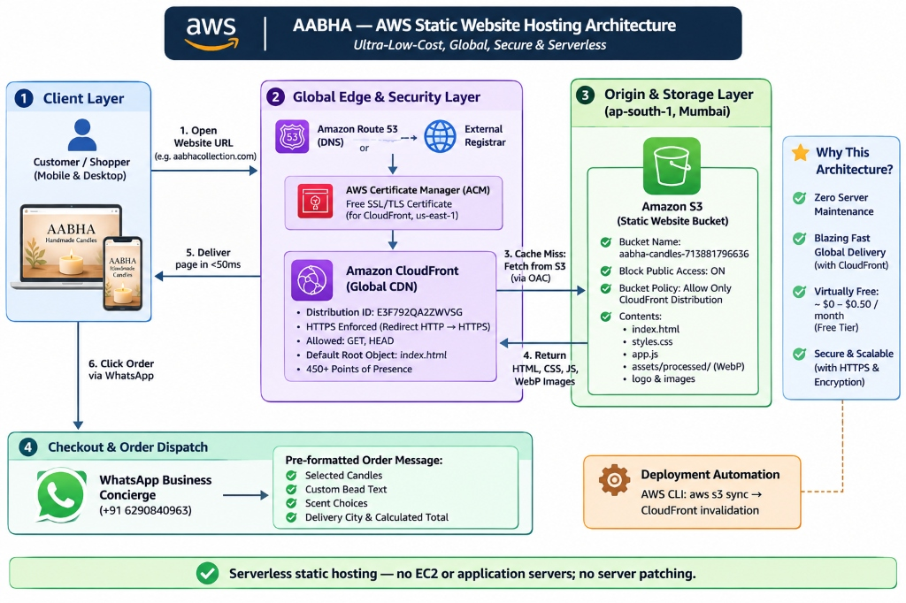
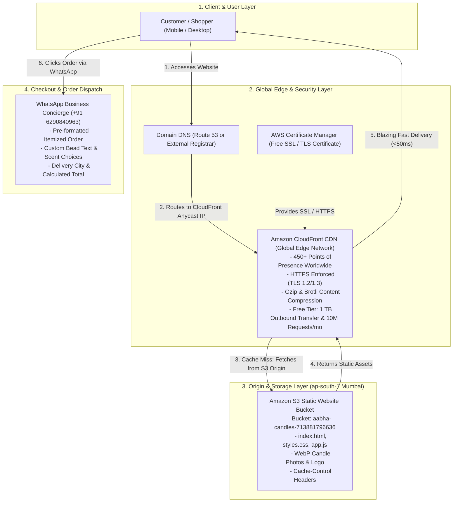

# 🌸 AABHA - Handcrafted Candles & Wax Art Studio

> **"Light · Love · Celebrate"**  
> An elegant, serverless e-commerce & catalogue website for **AABHA** handmade candle studio, built with modern static web standards and deployed on AWS S3 & CloudFront with WhatsApp Business ordering integration.

---

## 🌐 Live Website

* **Production URL (CloudFront Global CDN + HTTPS):** [https://dbsko5bhpx48x.cloudfront.net](https://dbsko5bhpx48x.cloudfront.net)
* **Direct S3 Endpoint:** [http://aabha-candles-713881796636.s3-website.ap-south-1.amazonaws.com](http://aabha-candles-713881796636.s3-website.ap-south-1.amazonaws.com)
* **Official Instagram:** [@aabha.collection](https://www.instagram.com/aabha.collection)

---

## ✨ Features

- **Warm Earthy Minimalist Luxury Design:** Cormorant Garamond editorial serif paired with Plus Jakarta Sans, soft linen ivory tones, warm glow backdrops, and gentle flame animations.
- **Official Brand Logo Integration:** Integrated circular botanical rose-gold monogram emblem.
- **Interactive Candle Catalogue:**
  - Category filters: *Botanical Bouquets, Floating Lotus Bowls & Message Candles, Oceanic Gels, Floral Sculptures, Gourmand Specials, Gift Curations*.
  - Real-time search by fragrance note, candle type, or category.
  - Scent notes breakdown (*Top, Heart, Base notes*), burn times, and wax composition.
- **Personalization Engine:** Custom bead text input for floating lotus bowls and secret message candles (e.g. *"Pyari Behna"*, initials, names).
- **Direct WhatsApp Order Bag:**
  - Client-side cart stored in `localStorage`.
  - Itemized order generation sent directly to WhatsApp Business (+91 62908 40963) with quantities, customizations, delivery city, and total.
- **Candle Care Guide:** 4-step burning rituals guide for optimal candle longevity.
- **Instagram Showcase:** Photo mosaic linking directly to social profile.

---

## 📁 Repository Structure

```
AABHA/
├── index.html                   # Semantic HTML5 layout with Tailwind CSS & Lucide icons
├── styles.css                   # Custom luxury styling, animations & typography
├── app.js                       # Centralized catalogue data, filters, bag & WhatsApp builder
├── assets/
│   └── processed/               # High-resolution, lightweight WebP product photos & logo
├── scripts/
│   ├── process_photos.py        # Pillow image cropping & enhancement pipeline
│   └── deploy_aws.py            # Boto3 automated S3 + CloudFront deployment script
├── AWS_DEPLOYMENT.md            # AWS low-cost serverless architecture documentation
├── .gitignore                   # Excludes raw camera media & credentials
└── README.md                    # Project documentation
```

---

## 🛠️ Local Development

1. Clone the repository:
   ```bash
   git clone https://github.com/rits1309/aabha-candle-studio.git
   cd aabha-candle-studio
   ```
2. Open `index.html` directly in your browser or start a local server:
   ```bash
   python -m http.server 3000
   ```
3. Open `http://localhost:3000` in your web browser.

---

## ☁️ AWS Architecture Diagram





### Architectural Highlights & Cost Analysis

| Component | Service | Role | Monthly Cost |
|---|---|---|---|
| **Edge CDN** | **Amazon CloudFront** | Delivers pages globally from nearest edge locations with SSL encryption | **$0.00** *(1 TB transfer & 10M requests free in AWS Free Tier)* |
| **Object Storage** | **Amazon S3** (`ap-south-1`) | Hosts compiled static files, WebP candle photos, and logo assets | **<$0.02** *(Pennies for ~15 MB storage)* |
| **Security & SSL** | **AWS Certificate Manager** | Managed public SSL/TLS certificate with automatic renewal | **$0.00** *(100% Free with CloudFront)* |
| **Ordering Engine** | **WhatsApp Direct API** | Frictionless client-side order formatting and messaging | **$0.00** *(No backend server required)* |
| **Total Estimated Cost** | — | — | **Virtually ₹0 to ₹10 / month (< $0.10)** |

---

## 📜 License

Created with love for **AABHA Collection**. All rights reserved.
